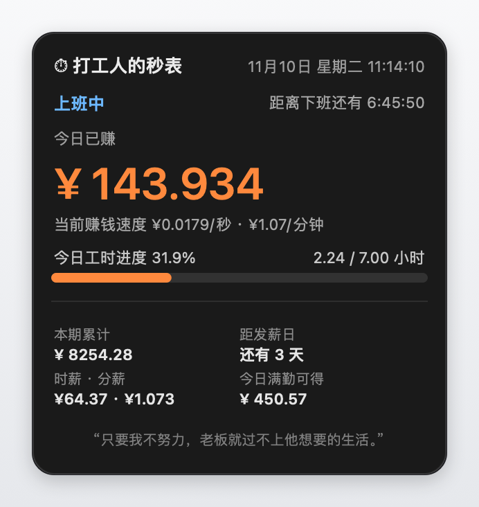

# 打工人的秒表

macOS 桌面悬浮窗小工具：把你的工资**按秒可视化**。

屏幕角落挂一张小卡片，实时显示今天已经赚了多少钱、距离下班还有多久、工时进度——数字每秒滚动上涨，摸鱼也有实感。

> 灵感来自 Windows 开源项目「牛马脱敏器」，界面与交互为 macOS 原生重写（Swift + AppKit），代码独立。

<picture>
  <source media="(prefers-color-scheme: dark)" srcset="assets/screenshot-dark.png">
  
</picture>

## 功能

- **实时计薪**：今日已赚金额秒级滚动，附当前赚钱速度（每秒 / 每分钟）
- **下班倒计时** + **今日工时进度**（进度条 + 已工作 / 应工作小时）
- **本期累计**：按发薪周期计算（从最近一个发薪日到今天）
- **距发薪日**：自动处理"15 号撞周末/法定节假日提前到最近工作日"的规则
- **时薪 / 分薪 / 今日满勤可得**：按你填的薪资自动折算
- **节假日日历**：内置 2026、2027 年国务院办公厅公布的法定节假日与调休上班日，节假日当天显示"休息中"且不计薪
- **极简模式**：双击卡片切换成只显示金额 + 倒计时的小条
- **缩放**：右键菜单「缩小 / 复原卡片」一键在 100% ↔ 85% 之间切换，设置面板也可 50%~100% 无级调节（布局和字号按比例重排，不是简单压缩）
- **主题**：深色 / 白色两套配色，可调卡片不透明度
- **纯本地**：零网络请求，不上传任何数据，配置存在本地 UserDefaults

## 安装

### 方式一：下载 DMG（推荐）

👉 **[下载 dagongren-miaobiao-v1.0.0.dmg](https://github.com/wh930303/dagongren-miaobiao/releases/latest/download/dagongren-miaobiao-v1.0.0.dmg)**（874 KB）

1. 打开 dmg，把 App 拖进「应用程序」
2. 首次打开如果提示"无法验证开发者"：**右键点 App → 打开 → 再点打开**，或在终端执行：
   ```bash
   xattr -d com.apple.quarantine /Applications/打工人的秒表.app
   ```

> 本 App 未使用 Apple 开发者证书签名（个人项目，省 99 美元/年），所以首次打开需要上述一次性的手动放行。

### 方式二：自己编译

需要 Xcode 命令行工具（`xcode-select --install`），macOS 13+：

```bash
git clone https://github.com/wh930303/dagongren-miaobiao.git
cd dagongren-miaobiao
./scripts/build.sh
```

产物在 `dist/`：通用二进制 `.app`（同时支持 Apple 芯片与 Intel）和 `.dmg`。

## 使用

启动后卡片出现在屏幕上，菜单栏会有一个 ⏱ 图标。

| 操作 | 效果 |
|---|---|
| 拖动卡片 | 移动位置（位置会记住） |
| 双击卡片 | 切换极简模式 |
| 右键卡片 | 设置 / 极简模式 / 缩小复原 / 隐藏 / 退出 |
| 菜单栏 ⏱ | 同上入口，可退出程序 |
| 设置 → 界面缩放 | 50%~100% 无级缩放 |

### 设置项

- **收入模式**：月薪 / 日薪 / 时薪（三选一）
- **每月计薪天数**（月薪模式）：默认 21.75
- **上下班时间**、**午休时段**（可勾选"扣除午休"，午休不计薪）
- **工作日**：周一到周日任意勾选
- **加班计薪**：下班后继续按倍率计费（默认关闭）
- **发薪日**：每月几号，遇周末/法定节假日自动提前到最近工作日
- **金额小数位**：0~6 位
- **卡片配色 / 不透明度 / 界面缩放**

开机自启：系统设置 → 通用 → 登录项 → 添加「打工人的秒表」。

## 计薪逻辑

```
时薪 = 月薪 ÷ 计薪天数 ÷ 每日计薪小时
每日计薪小时 = (下班 - 上班) - 午休（勾选扣除时）
今日已赚 = 已计薪秒数 × 每秒工资（加班按倍率）
```

- 法定节假日：不计薪，卡片显示"休息中"
- 调休上班日（周末补班）：正常计薪，即使你的工作日没勾周末
- 本期累计：从最近一个发薪日到今天的所有计薪日满勤金额 + 今天已赚

## 节假日数据

内置 `src/main.swift` 中的 `legalHolidays` / `makeupWorkdays` 两个集合，数据来源为国务院办公厅通知（2026 年、2027 年）。每年 11 月新一年放假安排公布后需要手动补充，欢迎提 PR。

**2027 年安排**（国办 2026-11-05 通知）：

| 节日 | 放假 | 调休上班 |
|---|---|---|
| 元旦 | 1/1–1/3（3 天） | — |
| 春节 | 2/5–2/13（9 天） | 1/31、2/14 |
| 清明 | 4/3–4/5（3 天） | — |
| 劳动节 | 5/1–5/5（5 天） | 5/8 |
| 端午 | 6/9（1 天） | — |
| 中秋 | 9/15（1 天） | — |
| 国庆 | 10/1–10/7（7 天） | 9/26、10/9 |

## 已知限制

- 未签名 / 未公证，首次打开需要手动放行
- 发薪日只支持 1–28 号（避免月末天数不一致的边界问题）
- 节假日数据硬编码，需要每年维护
- 只在 macOS 13+ 测试过

## License

[MIT](LICENSE) © 打工人的秒表 contributors
